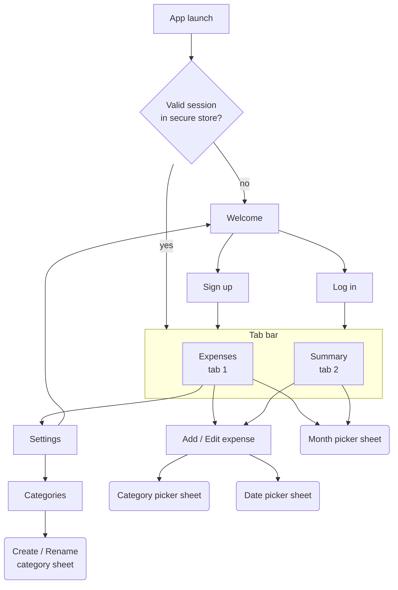
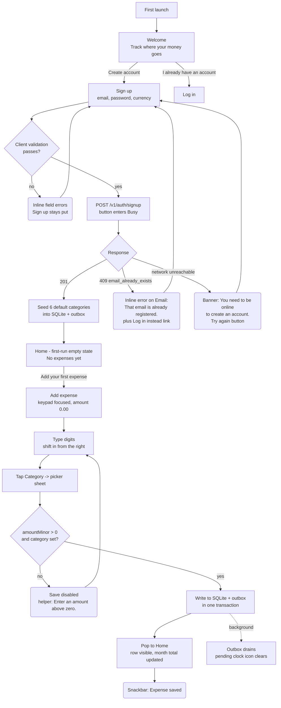
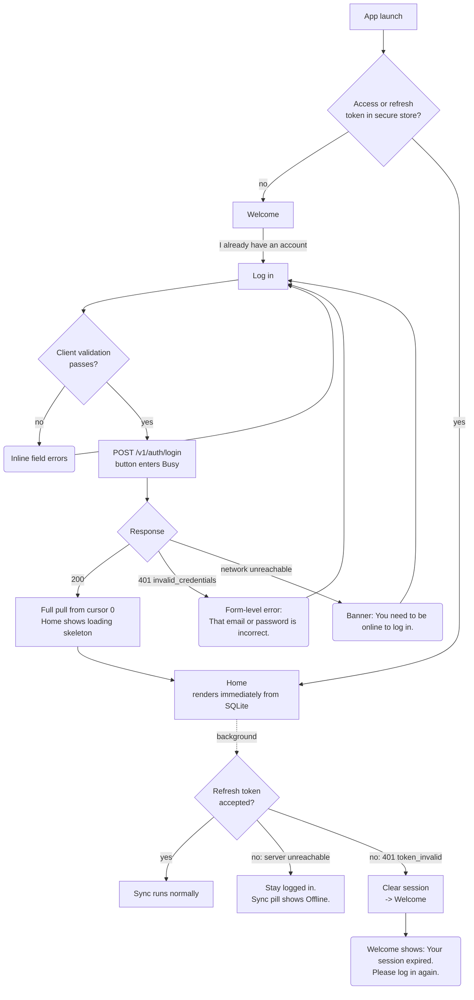
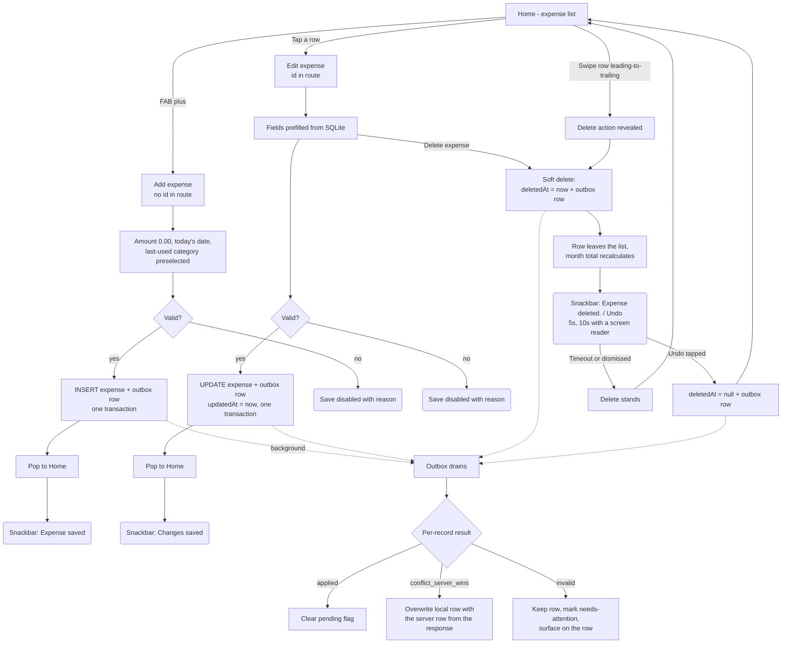

# User Flows

Owner: Designer · Last updated: 2026-10-06

Diagrams are Mermaid, so they render in GitHub and in most IDE previews without an image
export step. Screen names map 1:1 to the screen specs; route paths are given in each spec.

Legend:

- Rectangle = screen
- Rounded = a sheet, dialog or snackbar (overlay, does not replace the screen)
- Diamond = a decision the app makes, not a question put to the user
- Dashed edge = happens in the background, with no screen change

---

## 1. Navigation map

The whole app. Two tabs; everything else is pushed or presented over them.



Notes:

1. **Auth is a route group, not a modal.** `(auth)` and `(app)` are sibling expo-router groups.
   Switching between them replaces the stack, so there is no back-navigation from Home into
   Log in, and no back-navigation out of Welcome after logging out.
2. **Add and Edit are the same screen**, distinguished by whether the route carries an `id`.
   See [`06-expense-form.md`](./06-expense-form.md).
3. **Settings is reached from the Home app bar**, not a third tab — it holds three rows and does
   not earn tab real estate.
4. The month state is shared between Home and Summary: switching month on one and then changing
   tab shows the same month. See [`05-month-switcher.md`](./05-month-switcher.md) §Behaviour
   rule 7.

---

## 2. First launch → sign up → add first expense

The flow the acceptance criteria call out. The thing to notice is that **nothing after
"Create account" waits on the network.**



**Rule the diagram encodes:** signup is the _only_ point in this flow that can be blocked by
being offline, because it is the only point that needs a server to mint an identity. Once a
session exists, every subsequent step is local-first.

---

## 3. Returning user → log in



**The two rules that matter here**, both from `docs/PLAN.md` §Auth (a 60-day refresh token
exists precisely so offline-first is usable):

1. **Being offline never logs the user out.** Only an explicit `401` with
   `token_invalid` from a server we actually reached clears the session. A failed
   request, a timeout, or a DNS failure leaves the session intact.
2. **A returning user never sees a loading screen.** Home renders from SQLite on the first
   frame; the token refresh and the sync happen behind it. The skeleton in this diagram appears
   only after a _fresh_ log in, when there is genuinely no local data yet.

---

## 4. Add / edit / delete an expense



**Why an expense delete has no confirmation dialog.** Deleting one expense is a cheap,
single-row, fully reversible action, and the soft-delete model means Undo is a real restore
rather than a re-creation. A modal would tax the common case (correcting a mistyped expense) to
guard an uncommon one. **The confirmation is the Undo snackbar**, and it is specified as such —
see [`04-expense-list.md`](./04-expense-list.md) §Behaviour rules 7-9 for the exact timing,
dismissal, and what happens if the app is killed while the snackbar is up.

Category deletion is the opposite case and _does_ get a dialog, because it changes rows the user
is not looking at. See §5.

---

## 5. Delete a category

The one flow where the confirmation has to teach, not just ask. The expenses are **reassigned**,
never deleted (`docs/PLAN.md` §Deletes).

```mermaid
graph TD
    Cats[Categories] -->|Swipe row, or Delete in the rename sheet| Which{isDefault<br/>category?}
    Which -- yes --> Blocked(Snackbar: {fallbackName} can't be deleted.<br/>It's where expenses go when<br/>you delete a category.)
    Blocked --> Cats

    Which -- no --> Count[Count live expenses in<br/>this category, from SQLite]
    Count --> HasAny{count > 0?}

    HasAny -- yes --> DlgN(Dialog<br/>Delete Groceries?<br/>Its 23 expenses will move to<br/>Uncategorized. They won't be deleted.<br/>[Delete category] [Cancel])
    HasAny -- no --> Dlg0(Dialog<br/>Delete Groceries?<br/>It has no expenses.<br/>[Delete category] [Cancel])

    DlgN -->|Cancel, scrim, back| Cats
    Dlg0 -->|Cancel, scrim, back| Cats
    DlgN -->|Delete category| Do
    Dlg0 -->|Delete category| Do

    Do[One SQLite transaction:<br/>1. reassign expenses to the isDefault category<br/>2. soft-delete the category<br/>3. one outbox row per changed record]
    Do --> Result(Snackbar: Groceries deleted.<br/>23 expenses moved to Uncategorized.)
    Result --> Cats
    Do -.->|background| Push[Push in dependency order:<br/>categories, then expenses]
```

Rules the diagram encodes:

1. **The guard is the `isDefault` flag, not the name** — the server backs it with
   `category_not_deletable`, and the UI must not rely on matching the string
   "Uncategorized", which the user may have renamed. See
   [`00-foundations.md`](./00-foundations.md) §7 note 3.
2. **The count is exact and computed locally**, so it is correct offline. It counts expenses
   with `deletedAt IS NULL` in _all_ months, not just the month on screen.
3. **The copy states the outcome twice** — "will move to Uncategorized" and "They won't be
   deleted." The second sentence exists because "delete" in the button is the louder word, and
   losing spend history is the fear being addressed.
4. **No Undo for a category delete.** Reversing it means un-reassigning only the expenses this
   operation touched, which requires remembering a set of ids across a 5-second window and
   racing a sync. The dialog is the gate instead. The user can re-create the category and
   re-assign; the data is not lost either way.
5. **Reassign-then-delete is one transaction.** If it were two, a crash between them would
   orphan expenses against a deleted category.
6. The exact strings are in [`09-copy-deck.md`](./09-copy-deck.md); interpolation is
   `{name}`, `{count}` and `{fallbackName}`, with a singular form for `count === 1`.

---

## 6. The flows that are _not_ in this app

Stated so that nobody has to guess whether a screen was forgotten.

| Not present                      | Why                                                                                                                                                                                                                        |
| -------------------------------- | -------------------------------------------------------------------------------------------------------------------------------------------------------------------------------------------------------------------------- |
| Password reset / forgot password | Needs email delivery. Out of `docs/PLAN.md` scope. The Log in screen therefore has **no** "Forgot password?" link — an inert link would be worse than none.                                                                |
| Email verification               | Same reason. Signup logs the user straight in.                                                                                                                                                                             |
| Onboarding carousel              | The Home first-run empty state teaches the one action there is.                                                                                                                                                            |
| Change password / change email   | Not in scope. Settings shows the email as read-only text.                                                                                                                                                                  |
| Change currency after signup     | The data model has one currency per user and no conversion, so changing it would silently re-denominate existing expenses. Settings shows it read-only with the helper copy in [`09-copy-deck.md`](./09-copy-deck.md).     |
| Account deletion                 | Not in scope; no endpoint for it in `docs/PLAN.md` §5.                                                                                                                                                                     |
| A manual "Sync now" button       | Sync is automatic on the four triggers in `docs/PLAN.md` §Scheduling. There _is_ a Retry affordance, but only in the sync-error state where it is meaningful. See [`02-offline-and-sync.md`](./02-offline-and-sync.md) §4. |
